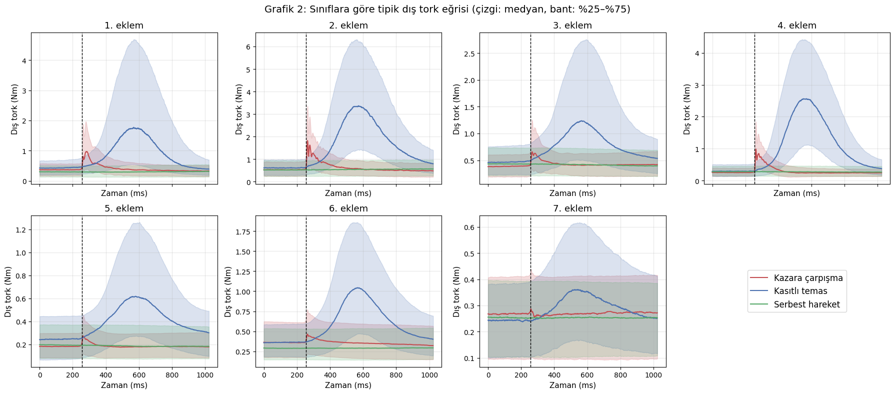
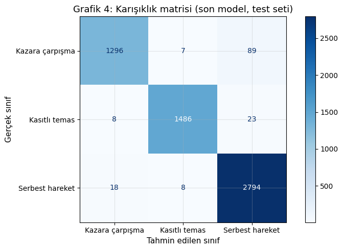

# Robot Kolunda Çarpışma ve Kasıtlı Temas Ayrımı

İnsanla aynı alanda çalışan bir robot kolu, bir temasın kazara bir çarpışma mı yoksa operatörün bilinçli bir yönlendirmesi mi olduğunu ayırt edebilmelidir: İlk durumda hemen durması, ikincisinde çalışmaya devam etmesi gerekir. Bu projede bu karar, ek kamera ya da sensör kullanmadan, yalnızca robotun kendi eklem tork sensörlerinden verilen bir sınıflandırma modeliyle ele alındı.

*Yedi eklem için sınıfların medyan tork eğrisi. Çarpışma temastan hemen sonra kısa ve keskin bir sıçrama yapıyor; kasıtlı temas yavaş yükselip yaklaşık 320 ms sonra zirveye ulaşıyor; serbest harekette tepe yok.*

## Sonuçlar

| Ölçü | Değer |
|---|---|
| Test doğruluğu | **%97,33** |
| Her pencereye "serbest hareket" diyen referans model | %49,22 |
| Kayıt sırasına göre ayrılan testte doğruluk (sızıntı kontrolü) | %96,25 |
| Yakalanan çarpışma oranı (recall) | %93,1 |
| Eğitim–test doğruluk farkı | 1,1 puan |

Modelin hatalarının büyük kısmı, torku çok az yükselten hafif çarpışmaların serbest hareket olarak sınıflandırılmasından kaynaklanıyor. Çarpışma ile kasıtlı temas ise 5.729 test penceresinde yalnızca 15 kez karıştı.

## Veri

- **Kaynak:** KUKA LWR4+ robot kolu, TU Münih — [Zenodo kayıt 6461868](https://zenodo.org/records/6461868) (CC BY 4.0)
- **Boyut:** 28.641 pencere × 7 eklem × 1.024 ölçüm (1 kHz), 21 CSV dosyası, yaklaşık 3,7 GB
- **Sınıflar:** kazara çarpışma (`cls`, 6.960), kasıtlı temas (`ctc`, 7.583), serbest hareket (`fre`, 14.098)

Veri boyutu nedeniyle depoya eklenmedi; notebook çalıştırıldığında Zenodo'dan otomatik olarak indirilir.

## Yöntem

1. **Veri kalitesi:** Eksik, sonsuz, sabit ve kopya pencere kontrolü; yedi eklem dosyasının satır satır aynı olaya ait olduğunun korelasyonla doğrulanması.
2. **Keşifçi analiz:** Sınıfların tork imzalarının incelenmesi. En güçlü tepki 2. eklemde (omuz), en zayıf 7. eklemde (bilek).
3. **Özellik çıkarımı:** Her eklemin 1.024 değerlik sinyalinden 5 özet değer: temas öncesi taban, tepe tork, yükseliş, zirveye ulaşma süresi ve temas sonrası ortalama (toplam 35 özellik).
4. **Model:** Karar ağacı. Derinlik, eğitim verisinden ayrılan doğrulama kümesinde seçildi (8); test kümesi yalnızca son değerlendirmede kullanıldı.
5. **Güvenilirlik:** Aşırı öğrenme kontrolü, kayıt sırasına göre bölme ile veri sızıntısı analizi ve hata analizi.

## Kaynaklar

- Veri seti: KUKA LWR4+ eklem dış tork verisi (çarpışma, kasıtlı temas, serbest hareket), TU Münih, [Zenodo 6461868](https://zenodo.org/records/6461868), CC BY 4.0.
- Zhang, Z., Qian, K., Schuller, B. W., Wollherr, D. (2020). *An online robot collision detection and identification scheme by supervised learning and Bayesian decision theory.* IEEE Transactions on Automation Science and Engineering, 18(3).
